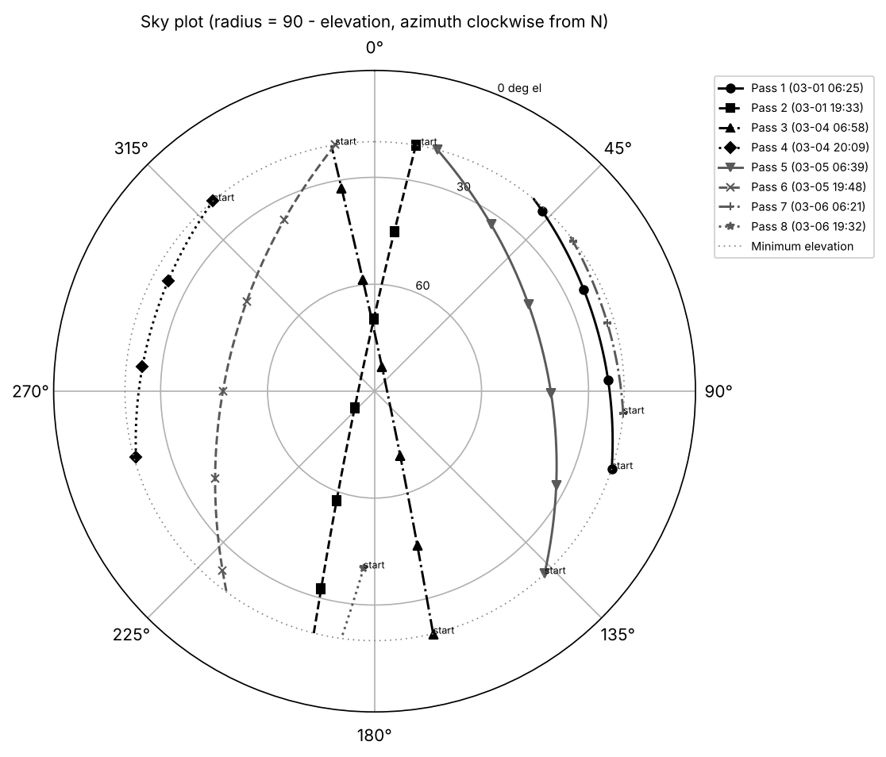
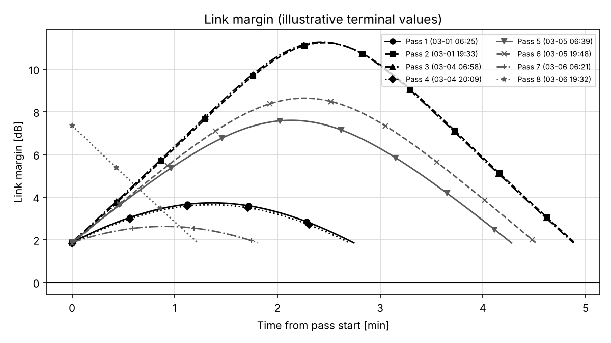

# opticalpass: LEO optical downlink pass planner

[](https://github.com/ThomasFarri/Satellite/actions/workflows/ci.yml)

Given a LEO satellite and an optical ground station, `opticalpass` finds the passes
usable for a laser downlink, computes the pointing profile of each pass (including
the point-ahead angle), estimates a simple link and data budget, ranks the passes
into a session plan, and demonstrates post-pass analysis of pointing telemetry.



Example scenario: a synthetic 500 km dawn-dusk sun-synchronous satellite over the
Tenerife optical ground station (approximate public coordinates), 1 to 8 March
2027, minimum elevation 20 deg, night only. Results from `configs/example.yaml`:

| Output | Value |
|---|---|
| Orbit (computed) | i = 97.402 deg from the J2 sun-synchronous condition, RAAN = 251.685 deg for 06:00 LTAN |
| Passes meeting all constraints | 8 in 7 days (14 geometric passes above 20 deg; night constraint removes 6 and trims 1) |
| Point-ahead angle | 25.1 to 51.5 urad |
| Peak azimuth rate (ground telescope) | 14.2 deg/s on an 86.6 deg pass |
| Maximum off-nadir angle (spacecraft) | 60.7 deg |
| Data volume, illustrative link | 1623 Gbit over 7 days, 232 Gbit/day |

All terminal and link values are illustrative assumptions in the config file. They
do not describe any real product.

## Quick start

Python 3.11 or newer.

```bash
git clone https://github.com/ThomasFarri/Satellite.git
cd Satellite
python -m pip install -e ".[dev]"
python -m opticalpass plan --config configs/example.yaml --out outputs/
python -m opticalpass postpass --config configs/example.yaml --out outputs/
```

`plan` writes `passes.csv`, `session_plan.csv`, `pointing_profiles.csv`,
`pointing_sensitivity.csv`, `summary.json` and plots of elevation and azimuth, the
sky track, point-ahead angle, link margin and pointing sensitivity. Add
`--propagator j2` to use the numerical propagator instead of SGP4.
`postpass` generates synthetic telemetry for one pass and recovers the injected
errors. Tests and validation:

```bash
pytest
ruff check .
python validation/run_validation.py
```

## Method

1. **Orbit.** Inclination solves the J2 nodal-rate condition for sun-synchronism.
   RAAN is set from the Sun's right ascension at epoch for the requested LTAN.
2. **Propagation.** SGP4 (`sgp4init` from mean elements, TEME output), or a
   two-body plus J2 model integrated with `solve_ivp` (DOP853, rtol 1e-11) starting
   from the SGP4 state at epoch.
3. **Frames.** TEME to ITRS through astropy. Geodetic to ECEF (WGS84), ECEF to ENU
   and azimuth/elevation/range are written by hand and checked against astropy's
   AltAz using a topocentric ITRS position, which avoids the stellar aberration
   correction astropy would otherwise apply.
4. **Passes.** Elevation sampled every 30 s, rise and set refined with `brentq` to
   1 ms, peaks between samples caught by a bounded maximisation. Passes are trimmed
   or split where the Sun separation (30 deg) or night (Sun below -6 deg)
   constraint changes state, and passes clipped by the analysis window are flagged.
5. **Pointing.** Azimuth, elevation, analytic rates, range and range rate for the
   telescope. For the spacecraft, the body frame is LVLH (+Z nadir), giving the
   line of sight in body axes, the off-nadir angle and the shortest-slew
   quaternion (scalar first, active rotation). Point-ahead = 2 v_perp / c from the
   inertial relative velocity, with station velocity omega x r, and its direction
   in body axes.
6. **Link.** Gaussian beam with w = theta R, received power P D^2 / (2 w^2) times
   optics efficiency, T_zenith^(1/sin el) and pointing loss exp(-2 (e/theta)^2).
   Margin against a required power, time with positive margin and data volume.
7. **Selection.** Passes ranked by deliverable data volume, top N kept in time order.
8. **Post-pass.** Least-squares fit of azimuth bias, elevation bias and clock offset
   to measured-minus-predicted residuals.



The link margin plot shows why pass geometry matters: the overhead passes reach
11.3 dB, the 22 deg pass only 2.6 dB. Pointing error is the main sensitivity. In
this example the daily volume is unchanged up to 10 urad of pointing error, falls
1.5 % at 15 urad, 38 % at 20 urad and 59 % at 25 urad
(`outputs/pointing_sensitivity.csv`).

## Assumptions and limitations

- No clouds, turbulence (scintillation, beam wander, fading), background light or
  detector model. The required received power stands in for all of these.
- No terrain or dome horizon mask; a flat 20 deg minimum elevation.
- Body frame equals LVLH. No attitude dynamics, slew limits or control errors.
- Numerical propagator: point mass plus J2 only. No drag, third bodies or solar
  radiation pressure. SGP4 runs with drag off (B* = 0).
- Plane-parallel airmass, Gaussian far-field beam, aperture much smaller than the
  beam footprint.
- Station coordinates are approximate public values.
- Earth orientation comes from astropy's bundled IERS table with downloads off,
  so runs are offline and repeatable. Predicted UT1-UTC typically differs from
  final values by a few ms, a few metres at the satellite.

## Validation summary

Full table with methods and tolerances: [docs/VALIDATION.md](docs/VALIDATION.md).

| Check | Result |
|---|---|
| Handwritten AER vs astropy AltAz | max 2e-15 rad elevation, 7e-6 mm range |
| Skyfield, same SGP4 and same IERS data | rise/set within 0.43 ms, elevation within 1.5e-5 deg |
| Skyfield, default settings | rise/set within 0.21 s; difference traced to Skyfield's older UT1-UTC table and no polar motion |
| J2 RAAN drift vs analytic | 0.98634 vs 0.98565 deg/day (0.07 %) |
| Two-body energy conservation, 2 days | 1.5e-11 relative |
| Point-ahead via independent GCRS route | 5e-8 relative |
| SGP4 vs numerical J2 (characterisation) | 2.93 km after 24 h, 20.8 km after 7 days, mostly along track |
| Post-pass recovery, synthetic telemetry | bias errors below 0.0002 deg, timing error below 0.0001 s |
| STK Access and AER | Not yet run (steps in `validation/stk/README.md`) |

## Repository layout

```
configs/example.yaml        scenario: orbit, station, constraints, illustrative terminal
src/opticalpass/
  constants.py              physical constants with sources
  config.py                 YAML loading, validation, conversion to SI
  orbit.py                  sun-synchronous design, RAAN for LTAN
  propagators.py            SGP4 and numerical two-body plus J2
  frames.py                 TEME/ITRS via astropy, handwritten geodetic/ENU/AER
  attitude.py               quaternions, LVLH, off-nadir, slew quaternion
  geometry.py               satellite-to-station geometry and Sun direction
  passes.py                 pass finding, constraints, trimming and splitting
  pointing.py               pointing profile and point-ahead
  link.py                   link budget, data volume, pointing sensitivity
  planning.py               end-to-end run, ranking, session plan
  postpass.py               synthetic telemetry and bias/timing recovery
  plots.py, cli.py          outputs and command line
tests/                      unit and integration tests (pytest)
validation/                 validation runner, Skyfield check, STK instructions and comparison
docs/                       VALIDATION.md, results JSON, sample plots
```

## Licence

MIT, see [LICENSE](LICENSE).
